# Recorded End-to-End System Demonstration

> **Platform**: Nextal HR & Payroll Management System (v1.0.0-rc1)  
> **Demonstration Deliverable**: Spec Section 16 Handover Package  
> **Target Environments**: Playwright Automated Browser Recording (1280x800)

This directory contains full video recordings and milestone frame captures for the three primary business flows specified in **docs/spec.md Section 16**:

---

## 1. Flow A: Company Setup & Organizational Onboarding
**Video Recording**: [`videos/flow-a-company-setup.webm`](videos/flow-a-company-setup.webm)

### Workflow Steps:
1. **Platform Administrator Provisioning**:
   - Platform Admin (`platform@nextal.ae`) authenticates and accesses the **Companies** directory (`/companies`).
   - Reviews active tenant licenses, MOHRE Establishment IDs, and provisions tenant administrators.
   - 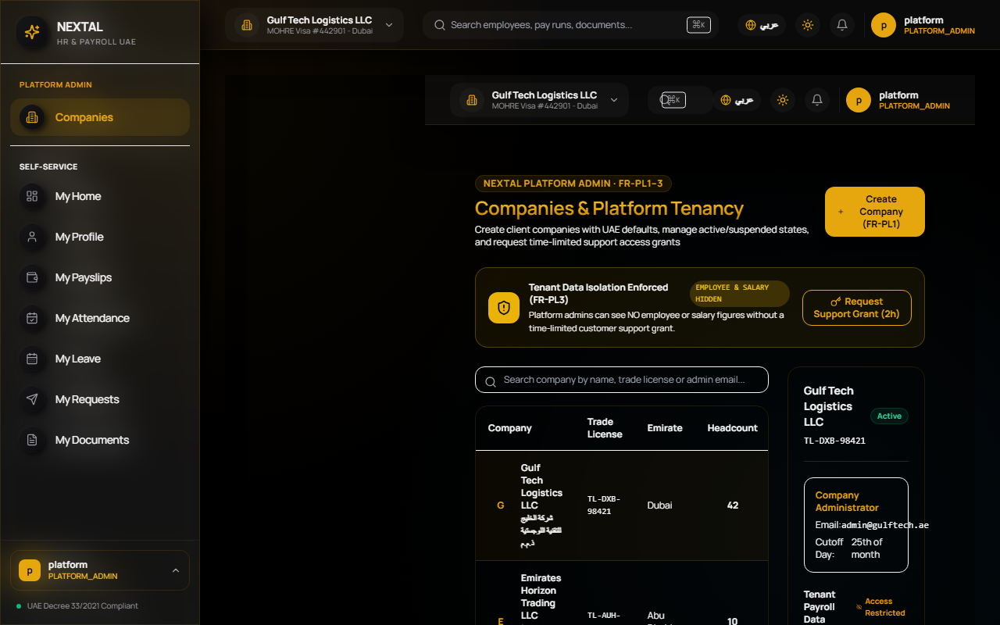

2. **Company Administrator Organizational Setup**:
   - Company Admin (`admin@gulftech.ae`) configures the organizational structure (`/organization`).
   - Sets up the 6 official departments (`Operations`, `Engineering`, `Sales & Support`, `Logistics & Fleet`, `HR & Admin`, `Finance`) with GL cost centres (`CC-OPS`, `CC-ENG`, `CC-SALES`, `CC-LOG`, `CC-HR`, `CC-FIN`).
   - Configures Sponsoring Visas (`Main Mainland Visa`, `Tech Freezone Visa`) and work shifts (`Standard Day Shift`).
   - 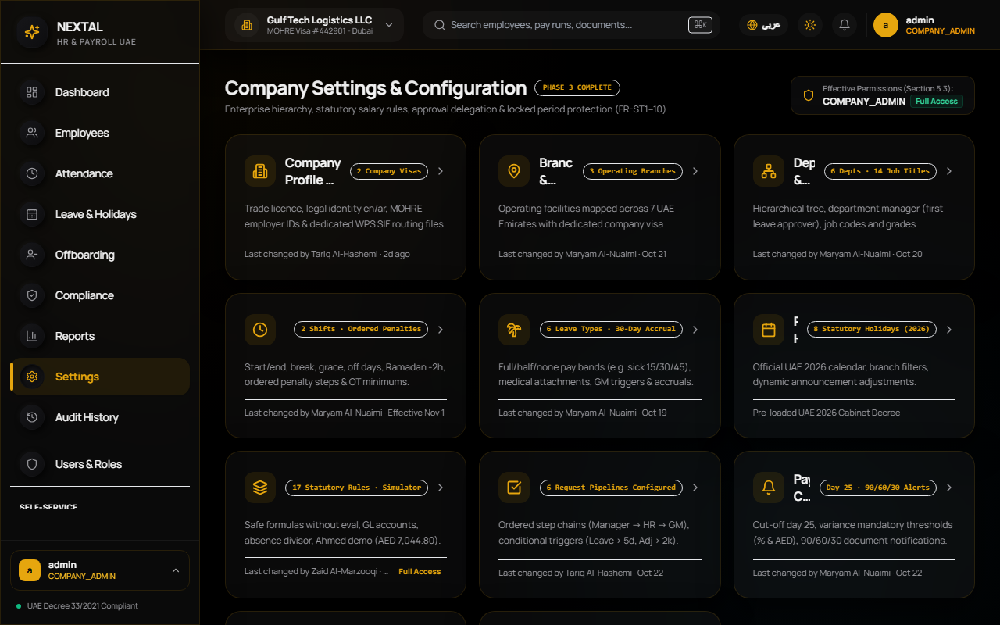

3. **Statutory Rules & Leave Parameters**:
   - Reviews company cut-off day (25th), absence divisor (`DIV_30`), overtime rate tiers (125% / 150%), and GPSSA pension parameters.
   - 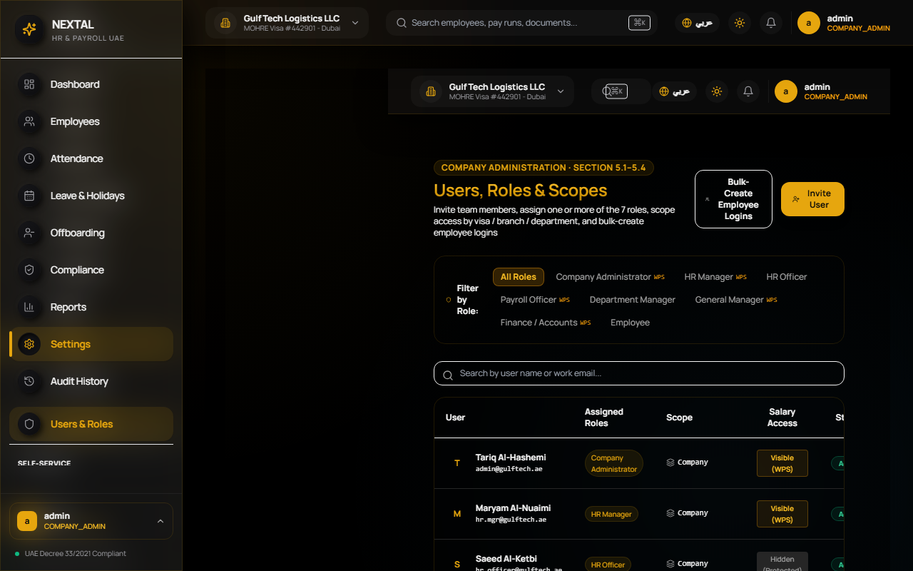

4. **Employee Onboarding**:
   - Navigates to **Employees** (`/employees`) to inspect active directory and onboarding workflow.
   - 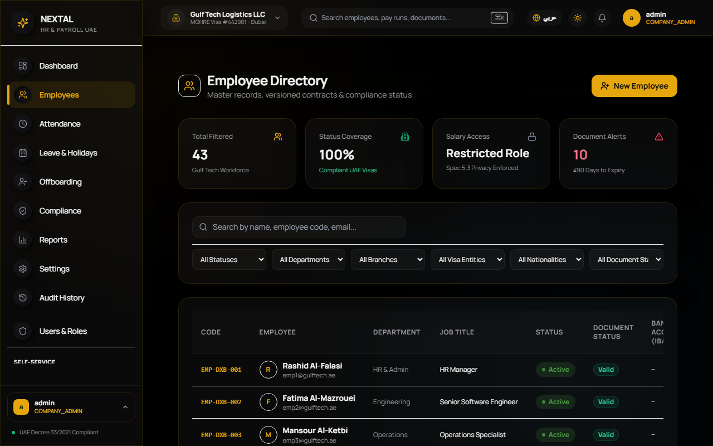

---

## 2. Flow B: Complete Monthly Payroll Cycle
**Video Recording**: [`videos/flow-b-payroll-month.webm`](videos/flow-b-payroll-month.webm)

### Workflow Steps:
1. **Attendance Reconciliation & HR Sign-Off**:
   - HR Manager (`hr.mgr@gulftech.ae`) verifies monthly attendance cards, punches, and overtime submissions in `/attendance`.
   - Confirms zero blocking attendance anomalies before monthly cut-off sign-off.
   - 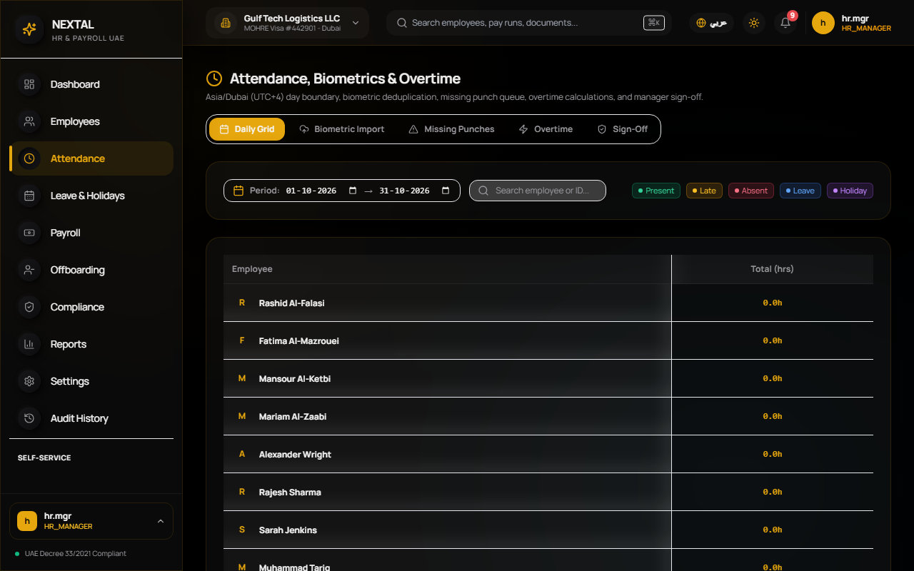

2. **Pay Run Calculation & Variance Analysis**:
   - Payroll Officer (`payroll@gulftech.ae`) executes the calculation engine for October 2026 (`/payroll`).
   - Analyzes payslip breakdown (Basic, HRA, Transport, Other, Overtime, Absences, Loans, GPSSA Pension).
   - Enters documented variance explanations for any employee with net pay change > 5%.
   - 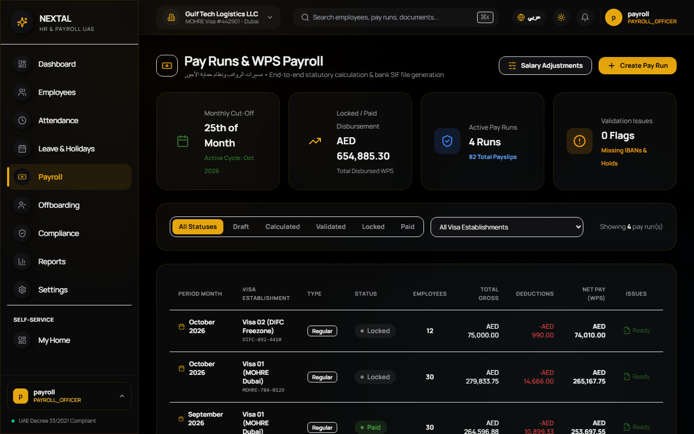
   - 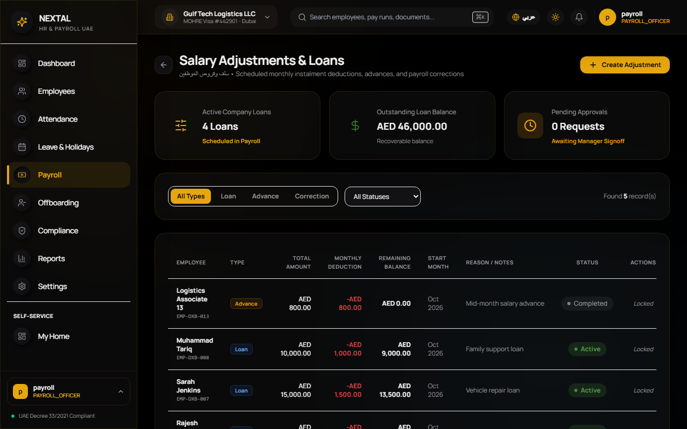

3. **Executive Approval & Finance Disbursement**:
   - General Manager (`gm@gulftech.ae`) reviews and approves the validated pay run.
   - Finance (`finance@gulftech.ae`) downloads the Central Bank compliant UAE WPS `.SIF` file and exports the double-entry General Ledger journal (`/reports`).
   - Finance records payment reference and marks the pay run `Paid`.
   - 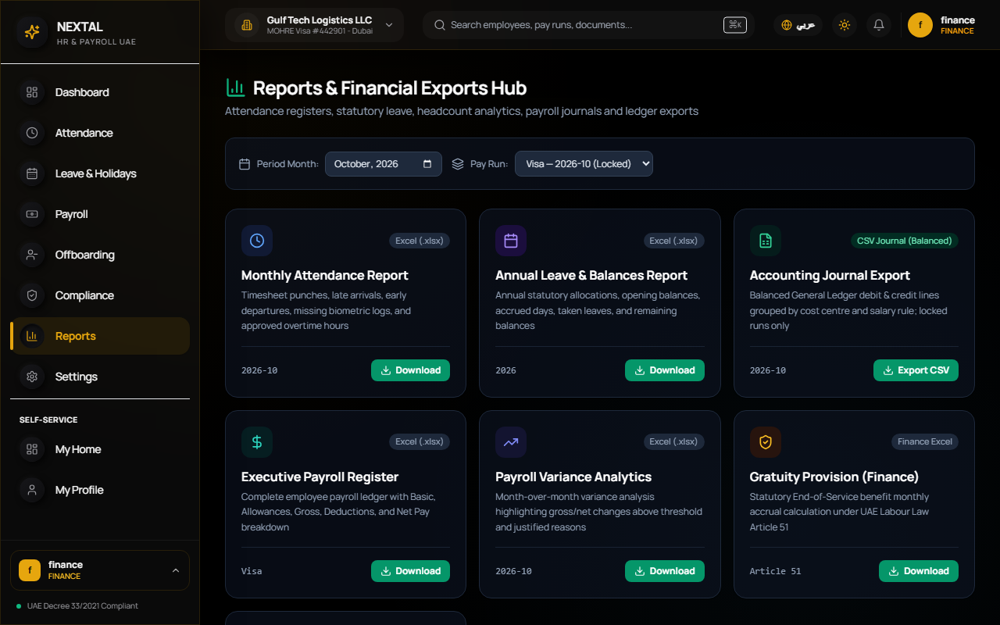

4. **Employee Self-Service Payslip Download**:
   - Employee (`employee@gulftech.ae`) accesses `/payroll/payslips` to inspect their monthly breakdown and download their official bilingual PDF payslip.
   - 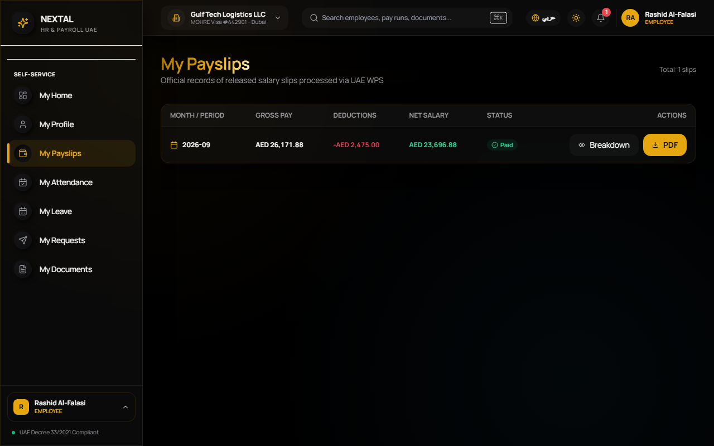

---

## 3. Flow C: End-of-Service Final Settlement & Offboarding
**Video Recording**: [`videos/flow-c-final-settlement.webm`](videos/flow-c-final-settlement.webm)

### Workflow Steps:
1. **Separation Initiation & Offboarding Directory**:
   - HR Manager (`hr.mgr@gulftech.ae`) monitors active separations in `/offboarding`, tracking Omar Al-Hashimi (`EMP-DXB-042`).
   - 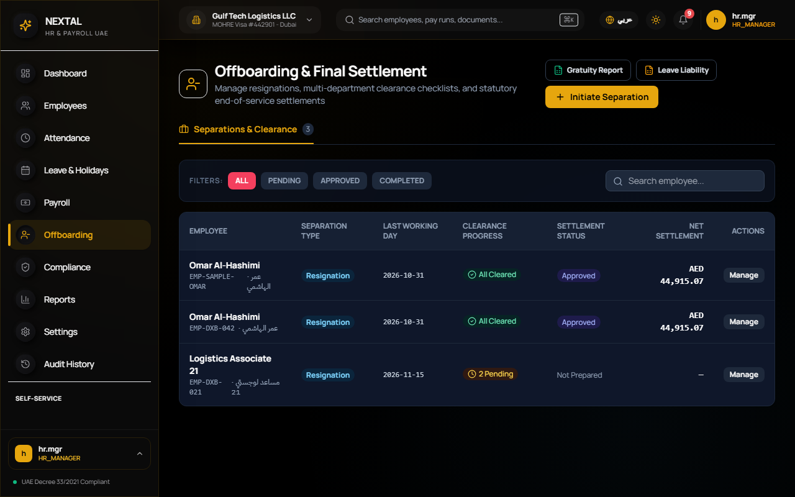

2. **Multi-Department Clearance & Article 51 Gratuity Calculation**:
   - Tracks clearance sign-offs across Assets/IT, Finance, Operations, and HR.
   - Evaluates the UAE Labour Law Article 51 Gratuity calculation:
     - 7.00 Years Service on Unlimited Contract
     - Basic Salary: AED 6,000.00 | Gross: AED 10,000.00
     - Gratuity Entitlement: **AED 32,547.95**
     - Unused Leave Encashment (12 days): **AED 4,369.86**
     - Outstanding Salary: **AED 8,000.00**
     - Net Final Settlement: **AED 44,915.07**
   - 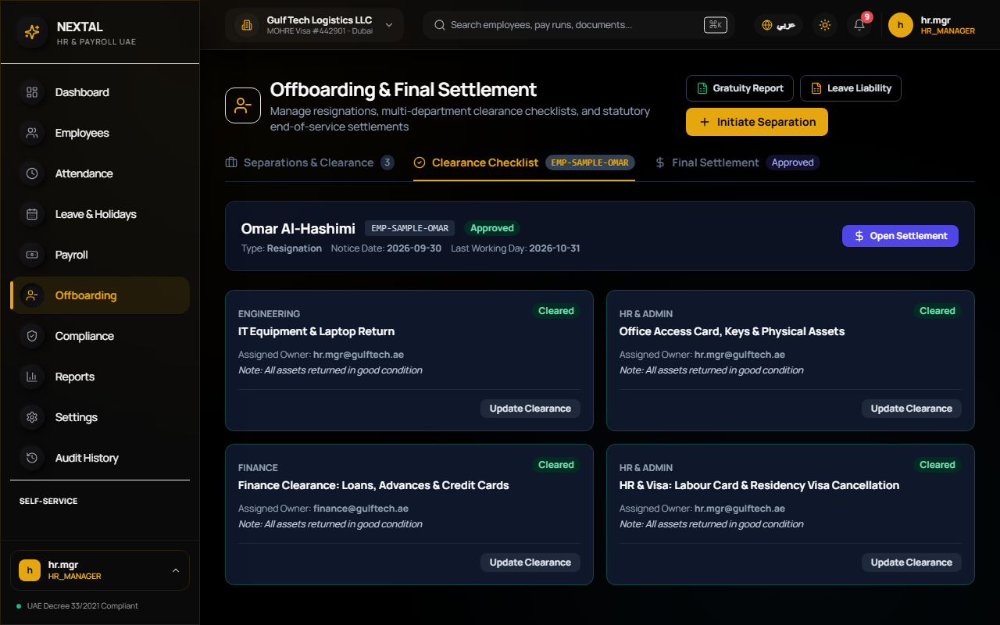

3. **Executive Approval & Finance Disbursement**:
   - General Manager approves final settlement statement.
   - Finance executes wire payment, uploads confirmation, and transitions employee status to `Separated`.
   - 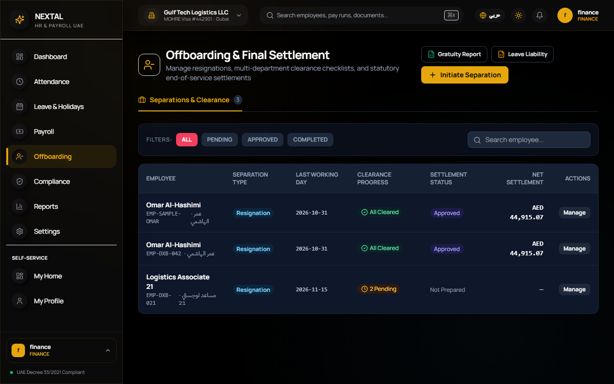
