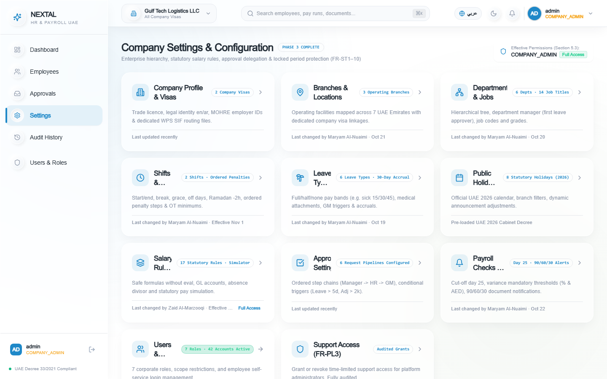
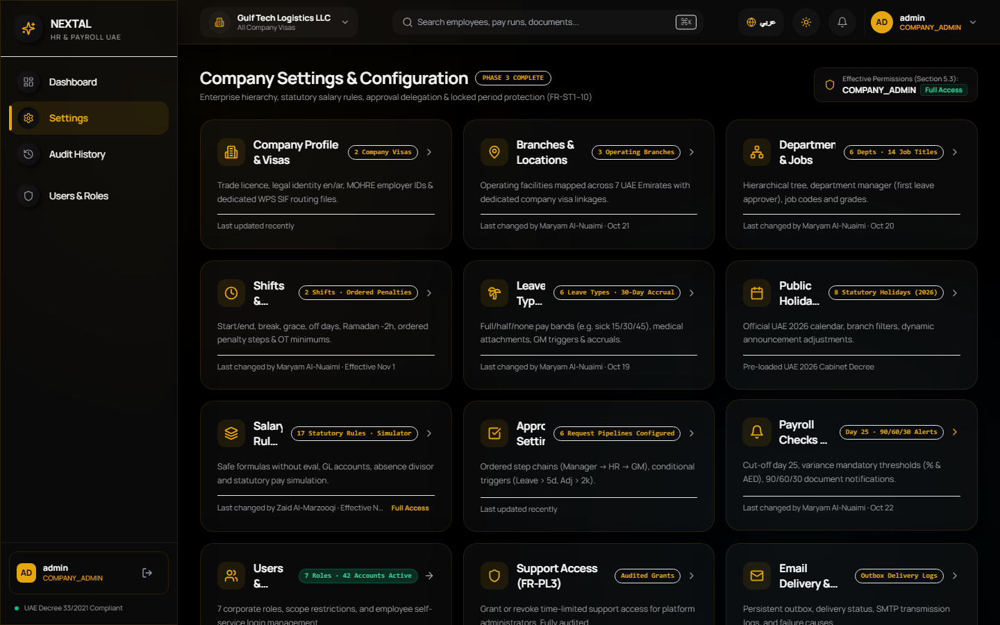
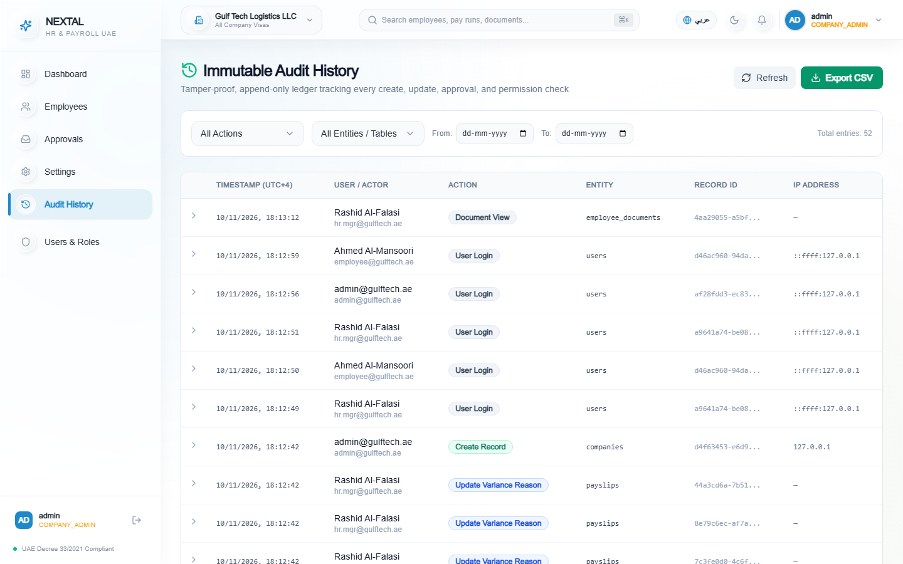

# Company Admin User Guide

> **Role Code**: `COMPANY_ADMIN`  
> **Target Audience**: Corporate Operations Directors, IT Managers, HR Directors  
> **Demo Login**: `admin@gulftech.ae` / `Nextal@2026!`  
> **Salary Visibility**: **No** (Compensation and salary figures are masked)

---

## 1. Overview & Key Responsibilities
The **Company Administrator** is the primary tenant administrator for the enterprise. This role manages organizational structure, company-wide settings, user accounts, corporate visas, branches, shifts, and holiday calendars:
- **Corporate Hierarchy**: Configure visas, branches, departments, jobs, and cost centres.
- **Statutory Settings**: Set cut-off days, variance alert thresholds, absence calculation divisors, and working hours.
- **User Delegation**: Invite staff members and assign roles (`HR_MANAGER`, `HR_OFFICER`, `PAYROLL_OFFICER`, `GM`, `FINANCE`, `DEPT_MANAGER`).
- **Audit Oversight**: Inspect immutable system audit logs with diff metadata.
- **Segregation of Duties**: The Company Admin cannot access or execute payroll runs, and cannot view or approve employee separations and final settlements.

---

## 2. Core Workflows

### 2.1 Visas & Branches Setup (Workflow 7.1 & VB)
1. Navigate to **Settings** (`/settings`) -> **Visas** tab.
2. Review company sponsoring visas: `Visa 01 (MOHRE Dubai)` and `Visa 02 (DIFC Freezone)`.
3. Switch to **Branches** tab:
   - `Dubai Headquarters (Al Quoz)` -> linked to Visa 01.
   - `Abu Dhabi Corniche Branch` -> linked to Visa 01.
   - `DIFC FinTech Hub` -> linked to Visa 02.
4. Each branch must belong to exactly one visa.

### 2.2 Shift & Attendance Policies
1. In `/settings`, navigate to **Shifts** tab.
2. Configure standard working hours (e.g. 08:00 to 17:00, 1-hour break) and grace minutes (15 min).
3. Changes immediately persist and are recorded in the audit trail.

### 2.3 User Management & Role Assignment
1. Navigate to **Users & Roles** (`/settings/users`).
2. Click **Invite User**. Enter user's work email and assign desired role.
3. System generates an invite link and sends an invitation email.

### 2.4 Audit Log Review
1. Navigate to **Audit** (`/audit`).
2. Filter by date, table (`employees`, `pay_runs`, `settings`), or action (`CREATE`, `UPDATE`, `DELETE`).
3. View exact JSON diffs (`old_values` vs `new_values`) capturing who changed what and when.

