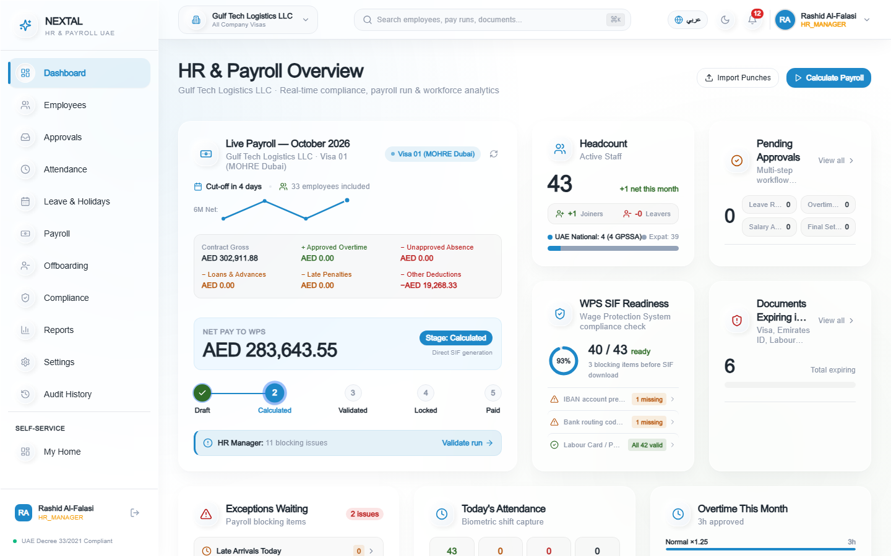
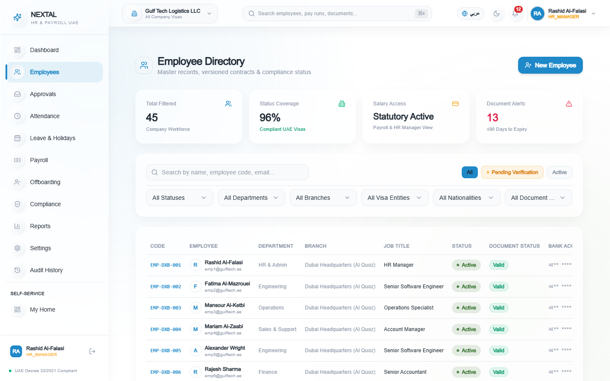
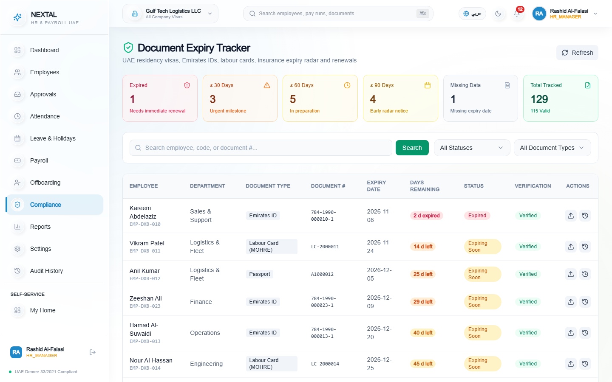

# HR Manager User Guide

> **Role Code**: `HR_MANAGER`  
> **Target Audience**: Human Resources Managers, People Operations Directors  
> **Demo Login**: `hr.mgr@gulftech.ae` / `Nextal@2026!`  
> **Salary Visibility**: **Yes** (Full HR & Statutory Salary Access)

---

## 1. Overview & Key Responsibilities
The **HR Manager** oversees the complete employee lifecycle, ensures UAE regulatory compliance under Federal Decree-Law No. 33 of 2021, and performs executive HR approvals:
- **Employee Lifecycle**: Verify new joiners (dual-control), approve contract versions, review history.
- **Attendance & Overtime**: Review monthly biometric timecards, sign off attendance before payroll cut-off.
- **Leave Administration**: Approve Step 2 leave requests, monitor statutory entitlements.
- **Pay Run Validation**: Validate calculated pay runs and variance documentation before GM locking.
- **Offboarding & Settlements**: Approve separations, oversee clearance checklists, validate Article 51 gratuity.
- **Statutory Compliance**: Verify renewed compliance documents, monitor upcoming expiry radars.

---

## 2. Core Workflows

### 2.1 Verifying a New Joiner (Workflow 7.2)
1. Navigate to **Employees** (`/employees`).
2. Filter by status `Pre-Joined`. Select the pending employee.
3. Review personal records, uploaded Emirates ID, passport, and visa.
4. If adjustments are required, click **Send Back** with mandatory review comments.
5. Click **Verify Employee** to approve. After payroll contract and bank setup, click **Activate** to grant self-service access.

### 2.2 Attendance Sign-Off (Workflow 7.3)
1. Navigate to **Attendance** (`/attendance`) and select the period (e.g. October 2026).
2. Ensure Department Managers have completed team reviews.
3. Review exceptions (tardiness, unapproved absences, approved overtime).
4. Click **HR Sign-Off** to freeze attendance inputs for the payroll engine.

### 2.3 Validating Payroll (Workflow 7.5)
1. Navigate to **Pay Runs** (`/payroll`) and open the `Calculated` pay run.
2. Inspect the **Variances** tab for any variance > 5% and verify documented justifications.
3. Click **Validate Pay Run**. Status transitions to `Validated` for GM approval.

### 2.4 Separation & Gratuity Oversight (Workflow 7.6)
1. Navigate to **Offboarding** (`/offboarding`).
2. Approve pending separation requests recorded by HR Officers.
3. Inspect multi-department clearance items (Operations, Finance, IT). Clear company/IT assets.
4. Inspect calculated Article 51 End-of-Service Gratuity and leave encashment. Click **Validate Settlement**.

### 2.5 Compliance Document Verification (Workflow 7.7)
1. Navigate to **Compliance** (`/compliance`).
2. Click on any document flagged `Pending Verification`.
3. Review uploaded renewal file in the verification drawer. Click **Verify Document**.

