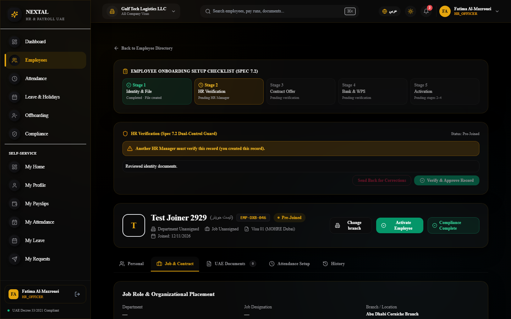
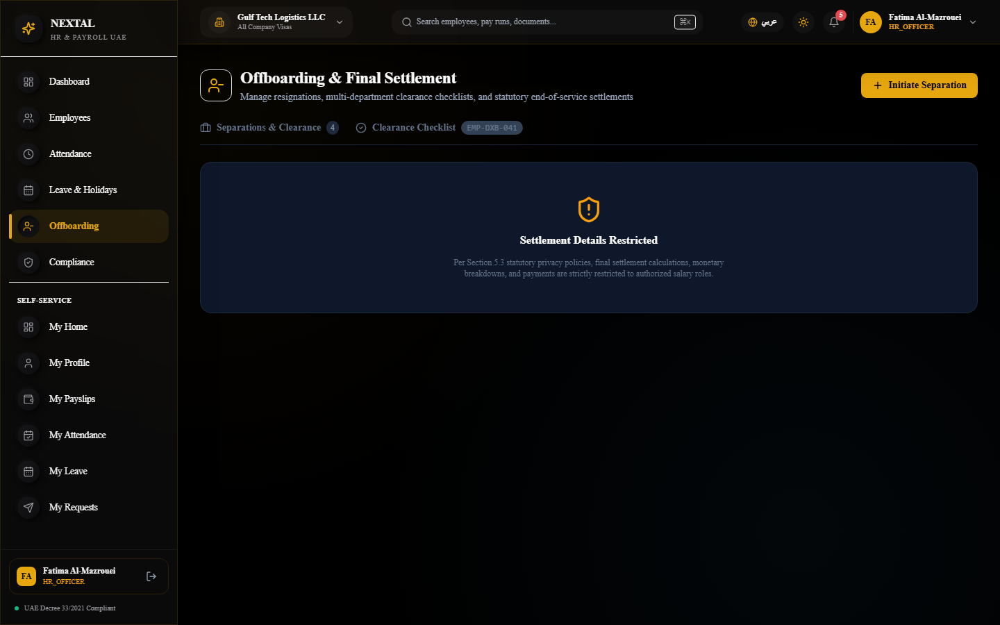

# HR Officer User Guide

> **Role Code**: `HR_OFFICER`  
> **Target Audience**: Human Resources Officers, Personnel Administrators  
> **Account Provisioning**: Invited by Company Administrator via Users & Roles (`/settings/users`) with temporary credentials.  
> **Salary Visibility**: **No** (All salary, wage, and compensation figures are strictly masked)

---

## 1. Overview & Key Responsibilities
The **HR Officer** handles day-to-day personnel administration, employee onboarding documentation, biometric timecard imports, and offboarding task execution:
- **Employee Setup**: Create new employee profiles (`Pre-Joined`), upload statutory identification documents.
- **Biometric Punch Import**: Upload biometric CSV timecard files, resolve missing punch exceptions.
- **Attendance Requests**: Review employee missing-punch requests.
- **Separation Intake**: Record resignations and terminations with notice dates and final working days.
- **Offboarding Tasks**: Mark visa and labour card cancellation tasks `Done` with official government reference IDs.
- **Privacy Assurance**: All salary, compensation, settlement amounts, and financial bank data are completely hidden from views and blocked at the API level.

---

## 2. Core Workflows

### 2.1 Onboarding a New Employee (Workflow 7.2)
1. Navigate to **Employees** (`/employees`) and click **Add Employee**.
2. Complete wizard fields: Legal English & Arabic names, DOB, Gender, Nationality, MOHRE Person ID, Sponsoring Visa, Branch, and Department.
3. Upload statutory documents: Emirates ID, Passport, Visa, and Labour Card.
4. Assign Shift, Attendance Policy, Biometric Device Code, and Leave Approver.
5. Save profile. Status is set to `Pre-Joined`. (Verification is handled by HR Manager under dual control).

### 2.2 Biometric Timecard Import (Workflow 7.3)
1. Navigate to **Attendance** (`/attendance`) and click **Import CSV**.
2. Select the vendor biometric export CSV.
3. The system processes punches, flags duplicate entries, and matches employee device codes.
4. Click on cells with missing punches. Enter verified punch time with mandatory audit justification.
5. Once team reviews are complete, click **Confirm HR Attendance**.

### 2.3 Recording Resignations & Offboarding Tasks (Workflow 7.6)
1. Navigate to **Offboarding** (`/offboarding`) and click **Record Separation**.
2. Select employee, resignation notice date, and final working day. Submit for HR Manager approval.
3. View the clearance checklist. When leaver status transitions to `Archived`, government cancellation tasks appear:
   - **Visa Cancellation**: Enter MOHRE/GDRFA cancellation reference number and mark Done.
   - **Labour Card Cancellation**: Enter MOHRE cancellation reference number and mark Done.

> [!NOTE]
> **Data Privacy Guarantee**: Notice in the screenshot above that on `/offboarding` clearance and settlement views, zero monetary amounts (`AED \d`) are displayed to HR Officers. The settlement tab presents a security privacy notice (`#settlement-restricted-notice`).

