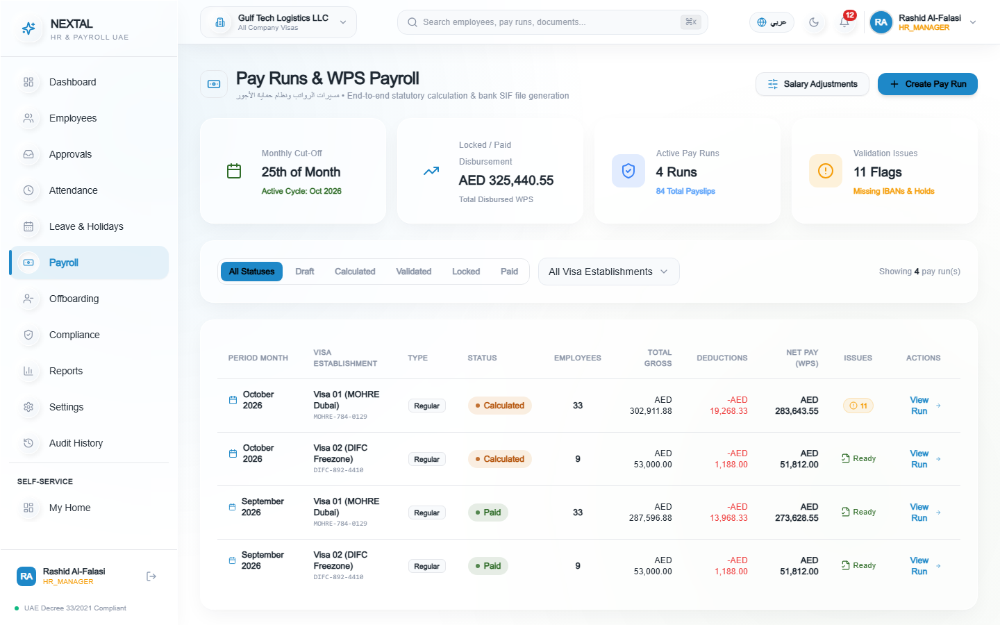
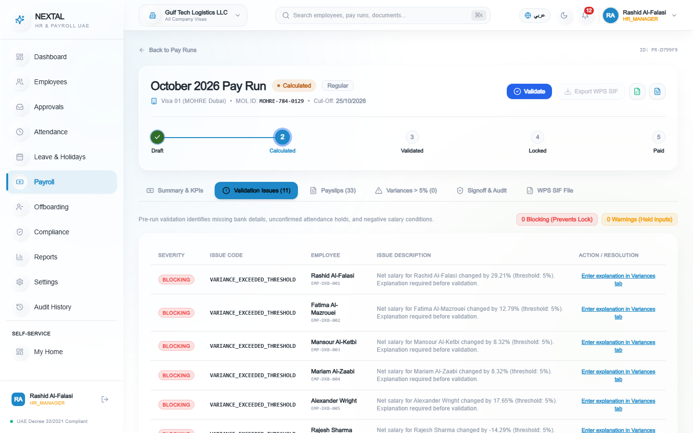
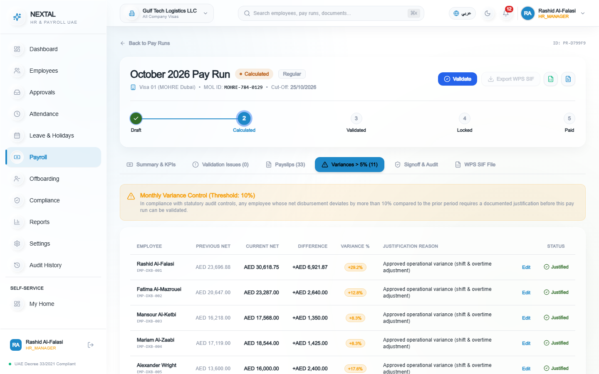

# Payroll Officer User Guide

> **Role Code**: `PAYROLL_OFFICER`  
> **Target Audience**: Payroll Specialists, Compensation & Benefits Analysts  
> **Demo Login**: `payroll@gulftech.ae` / `Nextal@2026!`  
> **Salary Visibility**: **Yes** (Full Payroll & Salary Computation Access)

---

## 1. Overview & Key Responsibilities
The **Payroll Officer** executes the monthly payroll lifecycle, validates variable inputs, manages employee contracts and bank accounts, and prepares final settlements:
- **Contract & Bank Management**: Create contract versions (Basic, Housing, Transport, Other), add and validate mod-97 UAE IBANs.
- **Pay Run Execution**: Create monthly pay runs per visa, ingest confirmed attendance hours, execute calculation.
- **Variance Analysis**: Document justifications for any employee variance exceeding 5%.
- **Payslip Release**: Generate bilingual PDF payslips after GM locking.
- **Final Settlement Preparation**: Calculate Article 51 End-of-Service Gratuity, unused leave encashment, and notice recovery.

---

## 2. Core Workflows

### 2.1 Setting Up Contracts & Validating UAE IBANs (Workflow 7.2)
1. In **Employees** (`/employees`), select an employee and open the **Contracts** tab.
2. Enter salary breakdown (Basic, HRA, Transport, Other). Submit for HR Manager approval.
3. Open the **Bank Account** tab. Enter employee bank name and 23-character UAE IBAN.
4. The system validates ISO 13616 Mod-97 checksums in real-time. Missing or invalid IBANs block future payroll inclusion.

### 2.2 Calculating Monthly Payroll & Validating Inputs (Workflow 7.5)
1. Navigate to **Pay Runs** (`/payroll`).
2. Select target visa (e.g. `Visa 01 (MOHRE Dubai)`) and month (e.g. `October 2026`).
3. Click **Validate Run** to inspect pre-calculation checks (missing contracts, unverified bank accounts, unconfirmed attendance).

4. Click **Calculate Payroll**. The engine computes statutory gross, GPSSA deductions, overtime additions, absence deductions, and active loan installments.
5. Open the **Variances** tab. For any variance > 5%, enter the operational justification.

6. Notify the HR Manager to perform validation. (Under segregation of duties, the Payroll Officer cannot validate or lock the run).

### 2.3 Calculating End-of-Service Settlements (Workflow 7.6)
1. Navigate to **Offboarding** (`/offboarding`) and select an approved separation.
2. Switch to the **Settlement** tab and click **Calculate Settlement**.
3. Review statutory breakdown:
   - Article 51 Gratuity (exact service days: 21 days/yr for 1–5 yrs, 30 days/yr for > 5 yrs; 0 for < 1 yr).
   - Unused leave encashment `(Gross * 12 / 365) * unused_days`.
   - Salary due to last working date minus loan balances and clearance deductions.
4. Click **Prepare Settlement**. Submit to HR Manager for validation.
