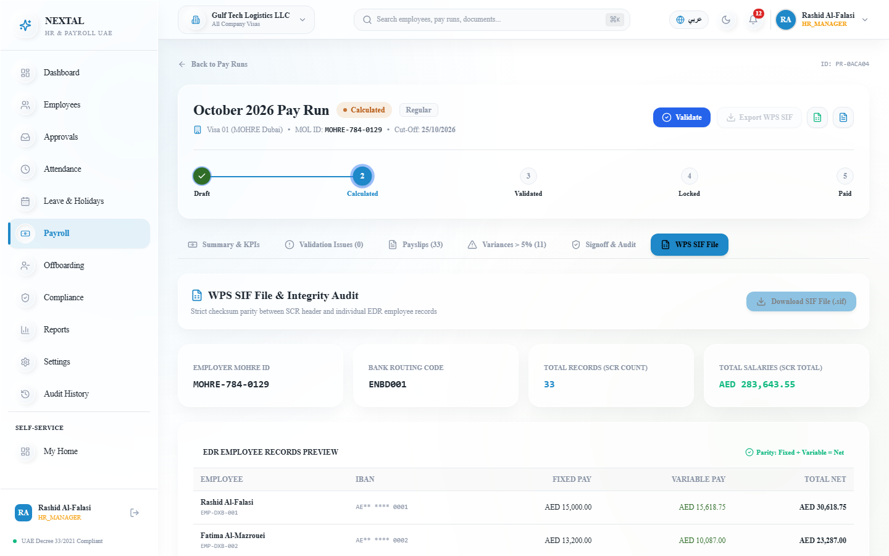
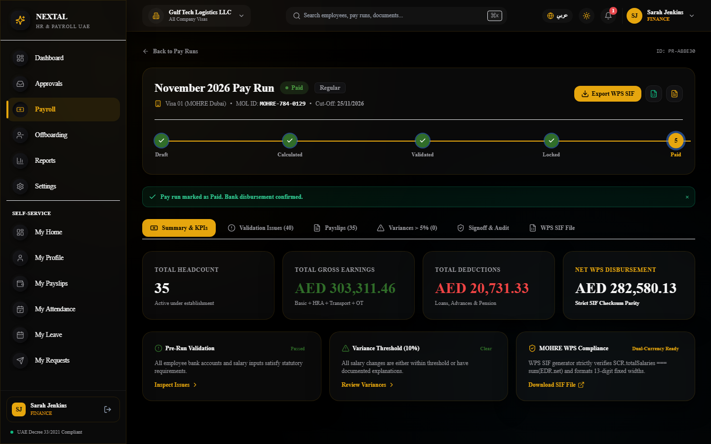

# Finance Officer User Guide

> **Role Code**: `FINANCE`  
> **Target Audience**: Financial Controllers, Chief Accountants, Treasury Officers  
> **Account Provisioning**: Invited by Company Administrator via Users & Roles (`/settings/users`) with temporary credentials.  
> **Salary Visibility**: **Yes** (Disbursement & General Ledger Access)

---

## 1. Overview & Key Responsibilities
The **Finance Officer** executes salary disbursements, generates official UAE Central Bank WPS Salary Information Files (SIF), manages staff loan recovery, and clears financial assets upon separation:
- **WPS SIF Export**: Generate compliant `.SIF` files for corporate banking portal upload.
- **Payment Execution**: Mark pay runs `Paid` after bank transfer confirmation.
- **General Ledger Accounting**: Export double-entry balanced GL CSV files grouped by cost center.
- **Financial Clearance**: Enter loan balances and asset deductions during offboarding.
- **Settlement Disbursement**: Mark final settlements `Paid` and download bilingual settlement PDFs.

---

## 2. Core Workflows

### 2.1 Exporting WPS SIF & Executing Payment (Workflow 7.5)
1. Navigate to **Pay Runs** (`/payroll`).
2. Open the pay run in `Locked` status (approved by GM).
3. Click **Export WPS SIF**.
4. The system validates:
   - 13-digit Employer MOL ID (`MOHRE-784-0129`).
   - 9-digit Bank Routing Code (`ENBD001`).
   - 23-character mod-97 UAE IBAN for every employee.
   - Mathematical equality: SCR Total Salaries == Sum of Net Payslips.
5. Upload `.SIF` to corporate banking portal (Emirates NBD smartBUSINESS / FAB Corporate).
6. Upon bank execution, click **Mark as Paid**.
7. Payslip release notifications are automatically dispatched to employees.

### 2.2 Financial Clearance on Separation (Workflow 7.6)
1. Navigate to **Offboarding** (`/offboarding`) -> open target separation -> **Clearance** tab.
2. Locate the Finance clearance item (e.g., Staff Loan / Advance Recovery).
3. Click **Update Item**. Select status `Cleared`, enter recovery amount (e.g. `1500.00`), and add notes.
4. Save. The deduction amount automatically maps into the settlement computation.

### 2.3 Settlement Disbursement (Workflow 7.6)
1. Navigate to the **Settlement** tab for an approved leaver (e.g. Omar Al-Hashimi).
2. Click **Mark Settlement Paid**.
3. Click **Download Settlement PDF** to generate the official bilingual Article 51 discharge statement.
