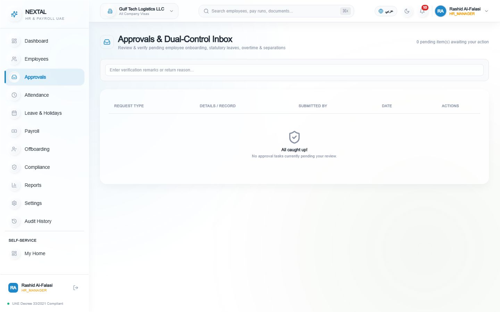
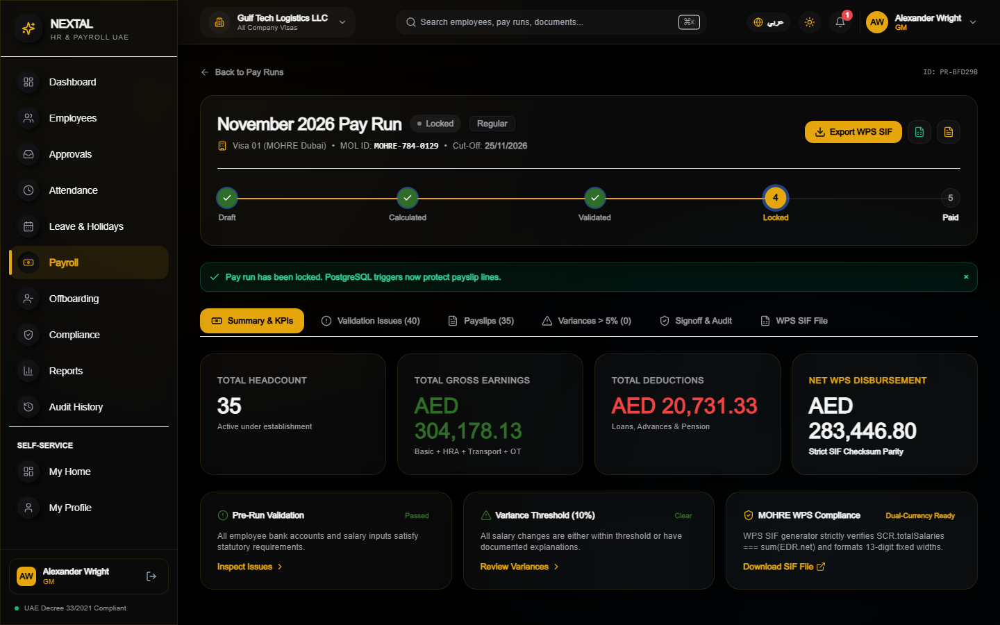

# General Manager (GM) User Guide

> **Role Code**: `GM`  
> **Target Audience**: General Managers, Managing Directors, Chief Operating Officers  
> **Demo Login**: `gm@gulftech.ae` / `Nextal@2026!`  
> **Salary Visibility**: **Yes** (Executive Oversight & Final Approval Access)

---

## 1. Overview & Key Responsibilities
The **General Manager** provides executive sign-off and enforces segregation of duties across the organization:
- **Pay Run Final Locking**: Review validated monthly pay runs and trigger the cryptographic freeze (`Locked`).
- **Final Settlement Approval**: Approve Article 51 final settlements before finance disbursement.
- **Extended Leave Authorizations**: Act as Step 3 approver for leaves exceeding 5 days or flagged leave types.
- **Branch Change Approvals**: Review and authorize employee branch transfers.

---

## 2. Core Workflows

### 2.1 Locking Monthly Payroll (Workflow 7.5)
1. Navigate to **Pay Runs** (`/payroll`).
2. Open the pay run currently in `Validated` status (verified by HR Manager).
3. Review total company wage commitment, headcount, and variance explanations.
4. Click **Lock Pay Run**.
5. **Database Freeze**: PostgreSQL triggers lock all 33 payslips and payslip lines. No recalculation or edits are permitted after lock.
6. Notifies Finance Officer to export SIF and process banking transfer.

### 2.2 Approving Final Settlements (Workflow 7.6)
1. Navigate to **Offboarding** (`/offboarding`).
2. Select a separation where clearance items are 100% complete and settlement is `Validated` by HR Manager.
3. If clearance items remain open (e.g. IT laptop pending), the system strictly blocks approval with `CLEARANCE_ITEMS_PENDING` (Spec T35).
4. Review Article 51 gratuity calculation, leave encashment, and net payable.
5. Click **Approve Settlement**.
6. The settlement record transitions to `Approved` (frozen). Notifies Finance for payment.

### 2.3 Executive Leave & Branch Authorizations (Workflow 7.4 & VB)
1. Navigate to **Approvals** (`/approvals`).
2. Review pending requests escalated to GM tier (extended annual leaves > 5 days, branch change requests).
3. Click **Approve** or **Reject** with optional review notes.
