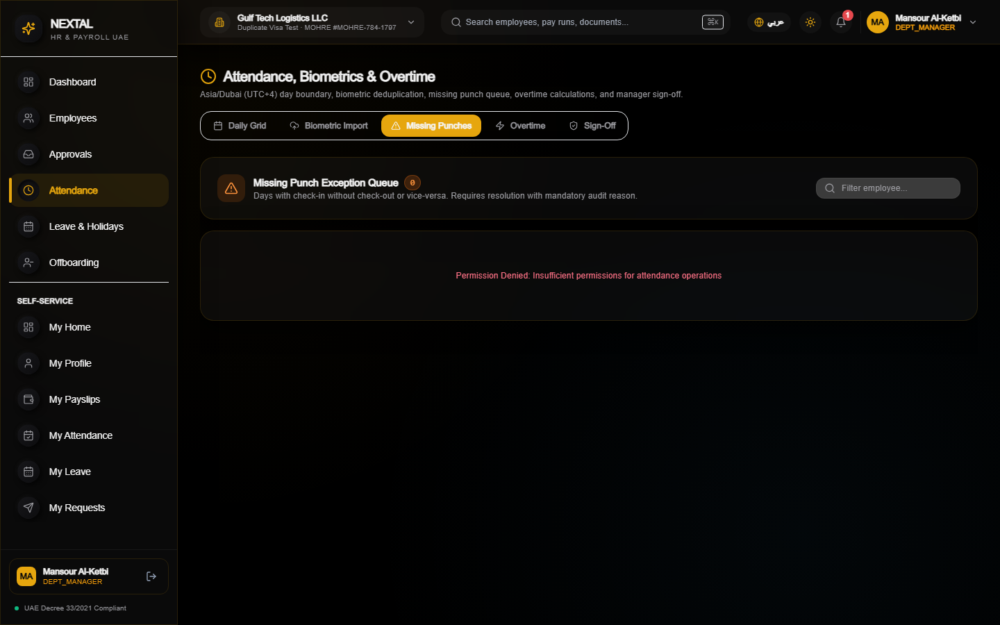
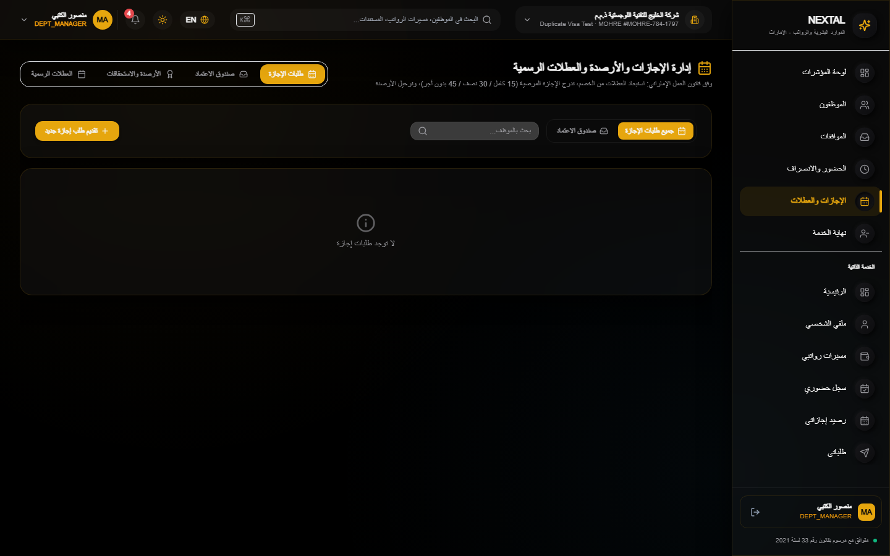

# Department Manager User Guide

> **Role Code**: `DEPT_MANAGER`  
> **Target Audience**: Department Heads, Operations Managers, Engineering Leads  
> **Demo Login**: `dept.mgr@gulftech.ae` (Operations Department Manager) / `Nextal@2026!`  
> **Salary Visibility**: **No** (Team salary figures are strictly masked)

---

## 1. Overview & Key Responsibilities
The **Department Manager** oversees operational workforce scheduling, reviews team attendance exceptions, authorizes overtime, approves Step 1 leave requests, and completes department clearance checklists:
- **Team Scope**: Scoped strictly to reporting direct reports in their assigned department (`Operations`).
- **Attendance & Overtime**: Review punch records, approve/refuse overtime (normal 1.25, night 1.50, holiday 1.50), confirm team monthly attendance.
- **Leave Authorizations**: Step 1 approver for team leave applications.
- **Department Asset Clearance**: Clear operational handovers and departmental assets on separation.
- **Privacy Assurance**: Compensation, hourly rates, and salary figures are completely hidden.

---

## 2. Core Workflows

### 2.1 Reviewing Overtime & Confirming Attendance (Workflow 7.3)
1. Navigate to **Approvals** (`/approvals`).
2. Review pending overtime requests submitted by team members or generated from extra biometric hours.
3. Classify and approve rate bands: Normal (1.25), Night (1.50), Holiday (1.50), or Substitute Day. Refuse invalid hours.
4. Navigate to **Attendance** (`/attendance`) -> filter by your department.
5. Review team punch cards. Click **Confirm Team Month**.
6. This signals to HR that team hours are validated for payroll inclusion.

### 2.2 Authorizing Team Leave (Workflow 7.4)
1. Navigate to **Approvals** (`/approvals`) -> **Leave Requests** tab.
2. Review employee leave request (type, duration, remaining balance, attachment if required).

3. Click **Approve** to advance request to HR Manager (Step 2), or **Refuse** with reason.

### 2.3 Departmental Clearance on Offboarding (Workflow 7.6)
1. Navigate to **Offboarding** (`/offboarding`).
2. Select separated team member -> open **Clearance** tab.
3. Locate the **Operations Handover** item.
4. Click **Update Item** -> select `Cleared` and enter confirmation note *"Operational tasks and project handover verified"*.
5. Save. The item transitions to Cleared.
