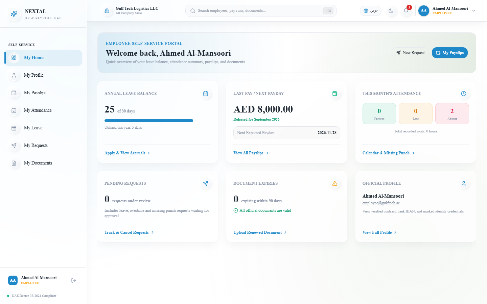
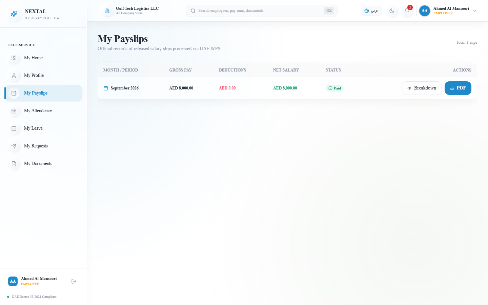

# Employee Self-Service User Guide

> **Role Code**: `EMPLOYEE`  
> **Target Audience**: All Enterprise Employees  
> **Account Provisioning**: Generated by Company Admin via Bulk Create Employee Logins (`/settings/users`) or self-service invite link.  
> **Landing Page**: `/me` (Personal Self-Service Portal)

---

## 1. Overview & Key Responsibilities
The **Employee Self-Service Portal** provides a dedicated, streamlined interface for staff members to access personal employment information, view and download payslips, submit leave and attendance requests, and upload compliance document renewals:
- **Personal Overview**: View employment profile, contract start date, assigned branch, and sponsoring visa.
- **Bilingual Payslips**: View breakdown of monthly salary, allowances, overtime, and deductions; download bilingual PDF payslips.
- **Leave Self-Service**: Check real-time leave entitlement balances, submit annual/sick leave requests with attachments.
- **Attendance Requests**: Submit missing-punch requests with explanation notes.
- **Compliance Renewals**: Upload renewed Emirates ID or Passport copies directly for HR verification.

---

## 2. Core Workflows

### 2.1 Viewing Payslips (Workflow 7.5 / Ahmed Spec T19)
1. Upon logging in, navigate to **My Payslips** (`/me/payslips`).
2. Click on the latest pay period (e.g. `October 2026`).
3. Inspect detailed breakdown:
   - Basic Salary, Housing, Transport, and Other Allowances.
   - Statutory additions (e.g. Overtime +AED 78.13).
   - Authorised deductions (Absence -AED 533.33, Staff Loan -AED 500.00).
   - **Net Salary**: **`AED 7,044.80`**.
4. Click **Download Payslip PDF** to generate official PDF with verified Arabic typography and English layout.

### 2.2 Applying for Leave (Workflow 7.4)
1. Navigate to **My Leave** (`/me/leave`) and click **Apply Leave**.
2. Select Leave Type (e.g. `Annual Leave`).
3. Select dates (e.g. Monday to Friday).
4. The system automatically detects statutory UAE public holidays and weekend rest days, displaying the exact net deductible working days (e.g. `4.0 Days`).
5. Attach supporting document if required (e.g. medical certificate for sick leave).
6. Submit. Track progress through Department Manager and HR approval stages.

### 2.3 Uploading Compliance Documents (Workflow 7.7)
1. When a document is approaching expiration, an alert banner appears on the dashboard.
2. Navigate to **My Documents** (`/me/documents`).
3. Click **Upload Renewal** next to the expiring document (e.g. Emirates ID).
4. Select the renewed file (PDF, PNG, JPG).
5. The document is uploaded, encrypted at rest with AES-256-GCM, and placed in status `Pending Verification` for HR Manager review.
